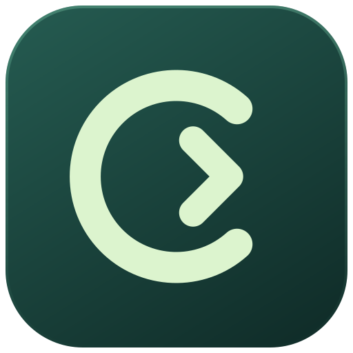

# OpenCast

An open-source launcher for macOS that works and looks like Raycast — with **your own AI
keys**, **your own sync server**, and **no paywalls**.

- **Bring your own AI.** Quick AI, AI Chat, AI Commands, presets, tools and MCP servers run
  through providers you configure: OpenAI, Anthropic, Gemini, OpenRouter, Groq, Mistral, xAI,
  DeepSeek, Ollama, LM Studio, or any OpenAI-compatible URL such as
  [CLIProxyAPI](https://github.com/router-for-me/CLIProxyAPI) or LiteLLM. Keys stay in your
  Keychain.
- **Self-hosted, end-to-end encrypted Cloud Sync.** Deploy the sync server to your own
  Cloudflare account (Workers + D1) with one script. Your data is encrypted on your Mac
  before it leaves it.
- **Everything unlocked.** Unlimited notes, unlimited clipboard history, custom themes,
  custom window management commands, Translator, AI — all free and local.
- **Raycast extensions.** OpenCast runs Raycast store extensions through a clean-room
  implementation of the `@raycast/api` runtime.
- **Import from Raycast.** Bring your snippets, quicklinks, notes and AI commands over from
  a Raycast `.rayconfig` export.

> OpenCast is an independent project. It is not affiliated with, endorsed by, or
> sponsored by Raycast Technologies Ltd. "Raycast" is a trademark of its owner.

## Features

| Area | What you get |
|---|---|
| Root search | Apps, commands, quicklinks, AI commands, scripts; fuzzy search with frecency, aliases, favorites, hotkeys, fallback commands, inline arguments |
| Calculator | Math, units, currencies, percentages, dates, time zones, number bases, colors, history |
| Clipboard History | Text, links, images, files, colors; search, pin, paste as plain text, paste sequentially, retention up to unlimited |
| Snippets | Keyword expansion in any app, dynamic placeholders (`{clipboard}`, `{date}`, `{cursor}`, `{argument}`, …) |
| Quicklinks | Templated links with `{query}` and arguments, open-with app, favicons |
| Notes | Floating Markdown notes with checklists and code, unlimited |
| Window Management | Halves, thirds, quarters, sixths, displays, Spaces, custom layouts, gaps |
| System | Lock, sleep, restart, volume, appearance, trash, eject, hidden files, … |
| AI | Quick AI (Tab from search), AI Chat window with branches and attachments, AI Commands, presets, web search, MCP tools, extension tools |
| Extensions | Raycast store browser, local/dev extensions, menu bar commands, background refresh |
| More | Emoji & symbols, file search, search menu items, My Schedule, script commands, translator, theme studio, confetti |

## Architecture

OpenCast follows Raycast 2's design: a thin Swift/AppKit host, a React UI in WebKit
views, and a Node backend. See [docs/ARCHITECTURE.md](docs/ARCHITECTURE.md).

```
apps/macos            Swift host: windows, hotkeys, clipboard, accessibility, Keychain
packages/backend      Node backend: data, search, AI, extensions, sync client
packages/frontend     React UI: launcher, AI Chat, Notes, Settings
packages/raycast-api  Clean-room @raycast/api runtime for extensions
packages/sync-worker  Cloudflare Worker + D1 sync server
packages/protocol     Shared TypeScript contracts
```

## Build and run

Requirements: macOS 14+, Xcode 16+ (Swift 6), Node 22.13+, pnpm 10.

Apple silicon DMGs are available from [the latest release](https://github.com/SergeSerb2/surgecast/releases/latest).
Node is included. Open the DMG and drag OpenCast.app to Applications. Current releases
are ad-hoc signed and are not notarized; macOS may require **Open Anyway** in
**System Settings → Privacy & Security** after the first launch attempt.

```sh
pnpm install
./scripts/build-app.sh --open          # builds everything into build/OpenCast.app
./scripts/build-app.sh --bundle-node   # also embeds the current node binary
./scripts/build-dmg.sh                 # builds and verifies a DMG, checksum, and source manifest
```

Press **⌥Space** to open OpenCast. Grant **Accessibility** permission when asked (needed for
window management, snippet expansion, selected text and pasting).

Browser development without the native host:

```sh
./scripts/dev.sh          # backend + Vite; macOS CLI fallbacks for native features
./scripts/dev.sh --mock   # UI only, in-browser mock data
```

## Upgrade from SurgeCast

OpenCast reuses an existing SurgeCast data directory and database in place. Fresh
installs use `~/Library/Application Support/OpenCast/opencast.db`. Existing Keychain
secrets, `.surgeconfig` backups, deep links, and encrypted sync vaults remain readable.
New exports use `.openconfig`, links use `opencast://`, and development variables use
`OPENCAST_*` (with `SURGECAST_*` aliases).

The private bundle ID and WebKit page origin stay stable to preserve macOS grants
and stored window preferences. Native autosave identifiers and the registered OAuth
callback also stay stable. Legacy preference keys are copied to the OpenCast
names before the UI loads. Existing sync deployments can keep their Worker URL and
D1 database; use their current resource names when deploying an update.

## Set up AI

Open **Settings → AI → Models & Providers**, add a provider, paste a key (or a base URL for a
local / proxy endpoint), and pick default models. Example for CLIProxyAPI running locally:
template **CLIProxyAPI**, base URL `http://127.0.0.1:8317/v1`, your proxy API key.

## Set up Cloud Sync

See [docs/SYNC.md](docs/SYNC.md). In short:

```sh
./scripts/deploy-sync.sh   # creates the D1 database, sets a token, deploys the Worker
```

Then open **Settings → Cloud Sync**, enter the Worker URL, the token, and an encryption
passphrase. Use the same passphrase on your other Macs.

## Documentation

- [Architecture](docs/ARCHITECTURE.md)
- [Cloud Sync](docs/SYNC.md)
- [Extensions](docs/EXTENSIONS.md) and the [extension UI contract](docs/EXTENSION-UI.md)
- [macOS releases and the local runner](docs/RELEASES.md)

## License

MIT — see [LICENSE](LICENSE). Bundled fonts: Inter and JetBrains Mono (SIL Open Font
License). Icons: Lucide (ISC).
